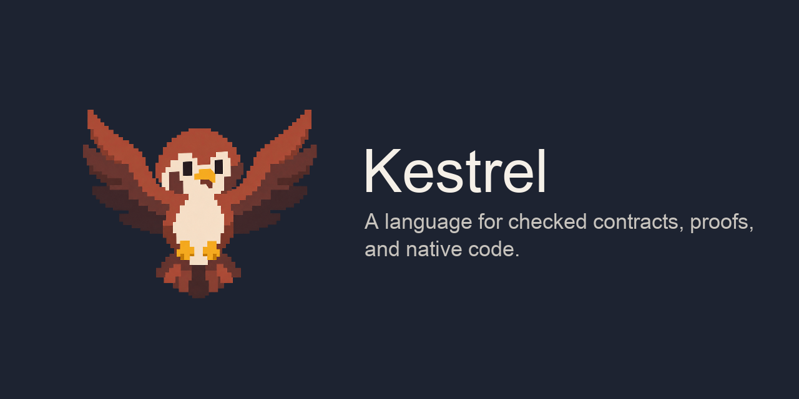
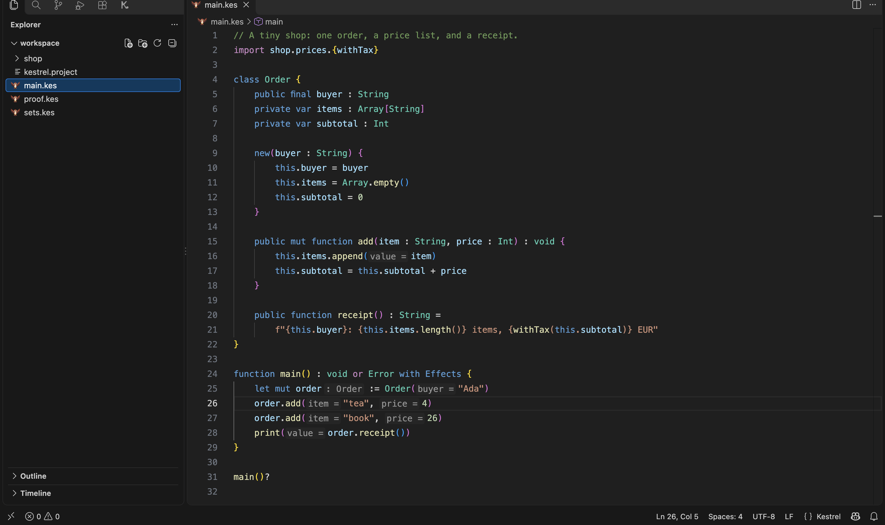
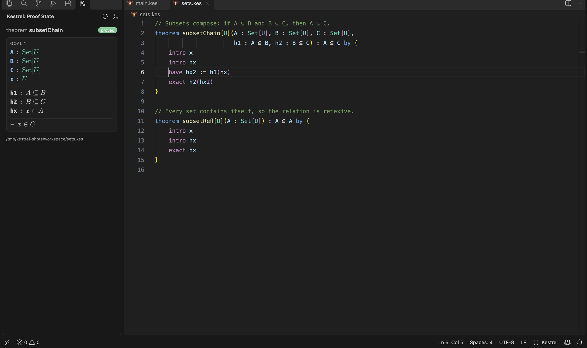
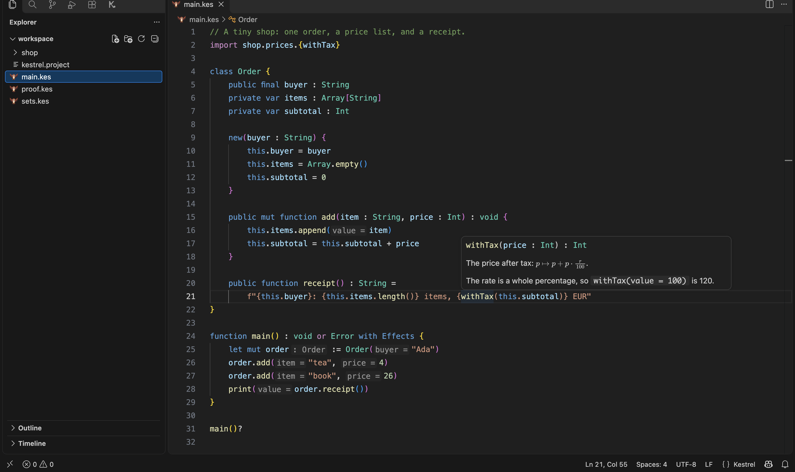
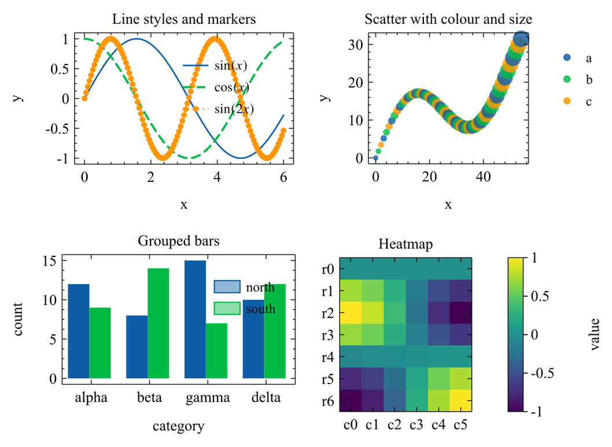

<p align="center">
  
</p>

<p align="center">
  A small language with a picky compiler. It checks your types, your errors, your memory, and your math<br>
  before the program runs, then hands the work to Clang.
</p>

<p align="center">
  
  
  
</p>

You write `.kes` files. One command reads them and tells you what it can prove and
what it cannot. `kestrel build` turns the same files into a native executable
through Clang. No interpreter, no virtual machine, and no toolchain to install.

The compiler checks four things:

- **Names and shapes.** Types line up, every `match` covers every case, and a
  call passes the arguments the function declared.
- **Outside work.** Printing, reading a file, and sending a request each need
  `with Effects`. A function without that mark cannot touch the world.
- **Ownership.** A value moves once, views cannot outlive their owner, and a
  borrowed object cannot be handed away.
- **Proofs.** The compiler can check a theorem, and it can make a function call
  depend on one.

If you have used Rust, OCaml or Lean, you will recognize the pieces: ownership
comes from Rust, the functional core from OCaml, and the theorems from Lean. Here
they share one toolchain.

## Try it

One command installs Kestrel and puts `kestrel` on your `PATH`.

macOS and Linux, with [Homebrew](https://brew.sh):

```sh
brew install GeronimoCastano/kestrel/kestrel
```

Windows, in PowerShell:

```powershell
irm https://raw.githubusercontent.com/GeronimoCastano/kestrel/main/install.ps1 | iex
```

Both bring everything Kestrel uses: a C compiler, LAPACK for linear algebra and
Z3 for `smt` proofs. Hello world is a single line. Save it as `hello.kes`:

```kestrel
print("Hello, Kestrel!")
```

```sh
kestrel run hello.kes
```

```text
Hello, Kestrel!
```

That is the whole setup. [SYNTAX.md](SYNTAX.md) documents every form.

## What it looks like

<p align="center">
  
</p>

<p align="center">
  <em>The VS Code extension. Parameter names sit in front of each argument, and the gray text after <code>let</code> is the type the compiler inferred.</em>
</p>

Here is the program on screen, in full. It imports `shop/prices.kes`, which
holds `withTax`, so the price list stays in one file.

```kestrel
// A tiny shop: one order, a price list, and a receipt.
import shop.prices.{withTax}

class Order {
    public final buyer : String
    private var items : Array[String]
    private var subtotal : Int

    new(buyer : String) {
        this.buyer = buyer
        this.items = Array.empty()
        this.subtotal = 0
    }

    public mut function add(item : String, price : Int) : void {
        this.items.append(item)
        this.subtotal = this.subtotal + price
    }

    public function receipt() : String =
        f"{this.buyer}: {this.items.length()} items, {withTax(this.subtotal)} EUR"
}

function main() : void or Error with Effects {
    let mut order := Order("Ada")
    order.add("tea", 4)
    order.add("book", 26)
    print(order.receipt())
}

main()?
```

Look at the markers on `add`. `mut` says the method changes the object. There is
no `with Effects`, because changing your own fields is not outside work.
`receipt` has no `mut`, so it cannot change anything.

## Errors are values, and you cannot drop them

A function that can fail says so in its type. `?` passes the failure up, and a
failed `?` at the top of a script prints a message and exits with status 1.

```kestrel
function divide(a : Int, b : Int) : Int or Error {
    if b == 0 { Error("cannot divide by zero") } else { a / b }
}

print(divide(10, 2)?)
print(divide(10, 0)?)
```

```text
5
error: RuntimeError.Message("cannot divide by zero")
```

The compiler also refuses to let you ignore a failure: `divide(10, 0)` on its own
line is an error. Write `let _ := ...` when you mean to throw it away.

## Proofs live in the same file

Kestrel ships a proof kernel: the part of the compiler that checks mathematical
steps, with no outside solver. A `theorem` states a fact about your functions,
and the kernel checks the proof. Code generation erases the theorem, so a proven
program costs nothing at run time.

```kestrel
enum Dog {
    Puppy(String)
    Adult(String, Bool)        // name, trained
}

function name(d : Dog) : String = match d {
    Puppy(n) => n,
    Adult(n, _) => n,
}

function isAdult(d : Dog) : Bool = match d {
    Puppy(_) => false,
    Adult(_, _) => true,
}

function canCompete(d : Dog) : Bool = match d {
    Puppy(_) => false,
    Adult(_, trained) => trained,
}

// For every dog: if it can compete, it is an adult.
theorem competitorsAreAdults(d : Dog) :
    isAdult(d) = true requires h : canCompete(d) = true {
    match d {
        Puppy(n) => absurd(h),
        Adult(n, trained) => rfl,
    }
}

// Callers now have to supply that fact.
function enter(d : Dog) : String requires competitorsAreAdults(d) =
    f"{name(d)} enters the ring"

let rex := Adult("Rex", true)
if canCompete(rex) == true { print(enter(rex)) }
```

The proof state updates while you type. The screenshot comes from another file,
where the cursor sits inside a `by { ... }` block and the sidebar shows the goals
that are still open:

<p align="center">
  
</p>

<p align="center">
  <em>Goals and hypotheses, typeset with TeX, from the same kernel that checks the file.</em>
</p>

Proofs travel as arguments and as results. A method that adds a job can return
evidence that the queue is nonempty, and the method that removes one takes that
evidence back.

## Hover shows the math

`///` comments support Markdown and LaTeX. The editor typesets the formulas, so
the signature, the formula, and the example line up in one place:

<p align="center">
  
</p>

## Data, numbers, and pictures

These libraries are written in Kestrel and call fast native code for the heavy
loops. They use the same compiler, so a data pipeline is checked like any other
program.

```kestrel
import std.kesdas.{DataFrame, Series}

let sales := DataFrame([
    Series(["jan", "feb", "mar"], name = "month"),
    Series([120, 80, 95], name = "north"),
    Series([90, 110, 105], name = "south"),
])
print(sales)
print(sales.col("north")?.mean())
```

```text
   month  north  south
0    jan    120     90
1    feb     80    110
2    mar     95    105
98.33333333333333
```

Matrices and vectors use the same type system. `A.T` is a read-only view with no
copy. `@` multiplies:

```kestrel
import std.linalg

let A := Tensor([1.0, 2.0, 3.0, 4.0, 5.0, 6.0], shape = (2, 3))
let x := Tensor([1.0, 0.0, -1.0])
print(A @ x)
print(A.T.shape())
print(linalg.dot(x, x))
```

```text
[-2.0, -2.0]
[3, 2]
2.0
```

Plotting writes SVG, PNG, JPEG, PDF or a standalone HTML page. Labels written as
`$...$` are typeset by your TeX installation and embedded as vector paths:

```kestrel
import std.kesplot as plt
import std.kesdas.{Series, DataFrame}

let sales := DataFrame([
    Series(["jan", "feb", "mar"], name = "month"),
    Series([120, 80, 95], name = "north"),
    Series([90, 110, 105], name = "south"),
])

let fig := plt.Figure(style = plt.Style.science())
fig.plotFrame(sales, x = "month", y = ["north", "south"], marker = "o")?
fig.title("Monthly sales")
fig.yLabel("orders")
fig.legend()
fig.save("sales.png", 140)?
```

<p align="center">
  
</p>

<p align="center">
  <em>Four figures drawn with <code>std.kesplot</code>, rendered with the <code>science</code> theme.</em>
</p>

Deep learning looks like PyTorch. The engine that computes gradients is native
code, not a Python library:

```kestrel
import std.kesnet.{Linear, ReLU, Sequential, mseLoss}
import std.kesnet.optim.{Adam}

let x := Variable.fromArray([1.0, 2.0, 2.0, 1.0, 4.0, 3.0, 5.0, 6.0].toArray(), (4, 2))
let y := Variable.fromArray([8.0, 7.0, 18.0, 29.0].toArray(), (4, 1))
let model := Sequential([box(Linear(2, 16)), box(ReLU()), box(Linear(16, 1))])
let mut optimizer := Adam(model.parameters(), 0.03)
for (epoch in range(400)) {
    let loss := mseLoss(model.forward(x), y)
    optimizer.zeroGrad()
    loss.backward()
    optimizer.step()
}
print(model.forward(x).data())
```

It prints `[[7.9158…], [7.1965…], [17.7899…], [29.1026…]]`, close to the targets 8,
7, 18 and 29. [KESNET.md](KESNET.md) lists the layers, losses, optimizers and
limits.

## The session keeps your values

`kestrel session` runs entries in one native process. Types, functions and
values stay alive between lines, so you can poke at a value and use it on the
next line. This is a real transcript:

```text
> let xs := [3, 1, 4, 1, 5, 9]
> xs.sorted()
[1, 1, 3, 4, 5, 9]
> xs.distinct()
[3, 1, 4, 5, 9]
> xs.sum()
23
> function square(x : Int) : Int = x * x
> square
square : (x : Int) -> Int
function square(x : Int) : Int = x * x
```

Type a name to see its signature and source. `:test` runs the package tests
without clearing your values, and `:quit` ends the session.

## Speed

Eleven programs that use only built-in features, measured on an M2 Max with
`python3 tools/run_language_benchmarks.py --runs 5`:

| Program | Kestrel | Rust | Kestrel / Rust | CPython |
|---|---:|---:|---:|---:|
| strings | 0.032 s | 0.066 s | 0.48 | 0.182 s |
| trees | 0.800 s | 2.700 s | 0.30 | 5.775 s |
| objects | 0.021 s | 0.056 s | 0.38 | 1.345 s |
| sorting | 0.023 s | 0.034 s | 0.70 | 0.794 s |
| numeric | 0.119 s | 0.101 s | 1.17 | 7.950 s |

Kestrel stays within 1.17x of Rust on all eleven programs and beats Rust on
strings, trees, objects, sorting and collections. CPython is between 1.4 and 87
times slower across the suite. Peak memory tracks Rust within 1.15x on every
program.

The library suites compare against NumPy, pandas, scikit-learn, PyTorch and
Matplotlib. Kesdas runs complete CSV pipelines 1.76x to 2.93x faster than pandas.
[BENCHMARK_REPORT.md](BENCHMARK_REPORT.md) has every table and names the
workloads Kestrel still loses.

## Install

| Platform | Command | What it brings |
|---|---|---|
| macOS (Apple silicon, Intel) | `brew install GeronimoCastano/kestrel/kestrel` | The compiler and Z3. Clang comes with the Command Line Tools Homebrew installs, LAPACK with macOS. |
| Linux x86_64 | `brew install GeronimoCastano/kestrel/kestrel` | The compiler, Clang, OpenBLAS and Z3 from Homebrew. |
| Windows 10 1903 or newer, x86_64 | `irm https://raw.githubusercontent.com/GeronimoCastano/kestrel/main/install.ps1 \| iex` | The compiler with its own Clang (llvm-mingw), OpenBLAS and Z3. No Visual Studio, no administrator rights. |

`brew upgrade kestrel` updates a Homebrew install; running the Windows command
again updates a Windows one. The Windows installer writes to
`%LOCALAPPDATA%\Programs\Kestrel`, adds its `bin` folder to your user `PATH`, and
installs the VS Code extension when `code` is on `PATH`. To remove it, delete that
folder and its `PATH` entry.

Every [release](https://github.com/GeronimoCastano/kestrel/releases) also has the
archives these commands use: `kestrel-<target>.tar.gz` for macOS and Linux, and a
complete `kestrel-x86_64-pc-windows-msvc.zip`, with `SHA256SUMS`. An unpacked
macOS or Linux archive needs Clang on `PATH`; Linux also wants `liblapack` or
OpenBLAS from your distribution for `std.linalg`.

From source, with Rust 1.95 or newer and Clang:

```sh
git clone https://github.com/GeronimoCastano/kestrel
cd kestrel
cargo build --release
```

`KESTREL_CC`, `KESTREL_LAPACK` and `KESTREL_Z3` name a C compiler, a LAPACK
library and a Z3 executable when you want ones other than Kestrel would find.
On Windows, `KESTREL_PYTHON` names the `python.exe` whose CPython programs embed.

### Supported platforms

CI runs the full test suite on macOS, Linux and Windows for every pull request,
installs each release the way the commands above do, and checks that a program
using Clang, LAPACK and Z3 runs. Kestrel is benchmarked on macOS.

On Windows, `kestrel run`, `kestrel build` and `kestrel session` compile project
C files and embed Python as on the other platforms; Python interop needs a
CPython from python.org. Kestrel also runs with Clang for MSVC when LLVM
and the Visual Studio Build Tools are on `PATH`.

## Commands

| Command | What it does |
|---|---|
| `kestrel run FILE` | Compile and run in one step |
| `kestrel build -o OUT FILE` | Save a standalone executable |
| `kestrel check FILE...` | Names, types, effects, moves, contracts, files, tasks |
| `kestrel test` | Run the `@test` functions in a package |
| `kestrel session` | Keep values alive between entries |
| `kestrel notebook` | Jupyter kernel for `.kes` cells |
| `kestrel serve` | Editor server behind the VS Code extension |
| `kestrel goals FILE --line N --column N` | Print the proof goals at a position |
| `kestrel parse` / `kestrel tokens` | Stop after the grammar / after the lexer |
| `kestrel fetch` / `kestrel update` | Dependencies pinned in `kestrel.lock` |

Any file argument accepts `-` for standard input. `check --stdin-path FILE -`
treats that input as an unsaved version of `FILE`, which is how the editor checks
a buffer you have not saved. `--emit-c PATH` keeps the generated C for
inspection.

## A project is a folder

Kestrel finds modules by path, the way Python does. `shop/prices.kes` is the
module `shop.prices`, with no header and no build script.

```text
demo/
  main.kes
  shop/
    prices.kes
```

```kestrel
// shop/prices.kes
public function total(price quantity : Int) : Int = price * quantity
```

```kestrel
// main.kes
import shop.prices.{total}

print(total(250, 3))
```

```sh
kestrel run main.kes      # 750
```

A folder with a `kestrel.project` file is a package. Two lines name it and list
its dependencies:

```text
package demo
depends geometry
```

`kestrel test` runs the `@test` functions under the package's `tests` folder, one
process per test, several at once.

## Editor support

The [`editors/vscode-kestrel`](editors/vscode-kestrel) extension adds syntax
highlighting, completions, hover documentation, go to definition, parameter-name
hints, inferred types, quick fixes, compiler errors as you type, and the live
proof state.

The extension talks to `kestrel serve`. Its **Kestrel Proof State** view shows
the variables, hypotheses and target as you move through a `by { ... }` proof,
typesets propositions with bundled MathJax, turns green when the kernel accepts
the proof, and marks `sorry` and trusted `smt` results in amber. Hover
documentation typesets `$...$` offline, so editing needs no TeX installation.
Completion, hover, go to definition and quick fixes all run locally.

Install it from the
[Visual Studio Marketplace](https://marketplace.visualstudio.com/items?itemName=kestrel-lang.kestrel-language):
search **Kestrel for VS Code**, published by `kestrel-lang`. The packaged VSIX is
also on the [releases page](https://github.com/GeronimoCastano/kestrel/releases):

```sh
code --install-extension kestrel.vsix
```

The extension finds `kestrel` on `PATH`, or in the folders the installers use, so
it works right after an install without restarting the editor.

From a checkout, `./editors/install-vscode-extension.sh` builds and installs it.
[docs/editors/vscode.md](docs/editors/vscode.md) covers the compiler path, Code
Runner, tasks, the settings that matter and troubleshooting.

`kestrel notebook` backs a Jupyter kernel. Each cell is one session entry, only
the last expression displays, and completion knows about `DataFrame`, `Series`
and `GroupBy` members.

## Development

```sh
cargo fmt --check
cargo clippy --all-targets -- -D warnings
cargo test
```

`cargo test` covers the front end, the checker, the proof kernel, the native
backend, the runtime, and the `mathlib` library. Programs the tests compile live
under `testdata/`.

## Versioning

Kestrel is pre-1.0. Within `0.1`, a patch release such as `0.1.3` fixes bugs and
leaves the language alone. A new form, a changed rule or a new language feature
bumps the minor number: `0.2.0`. Every release is listed in
[CHANGELOG.md](CHANGELOG.md).

## Limits

Kestrel is version 0.1. It refuses some programs on purpose. Each refusal comes
with a named diagnostic such as `E_NATIVE_OWNERSHIP` or `E_TRAIT_CONFLICT`,
never with silent bad output. The short list:

- A successful `check` does not promise the native backend supports the form.
  Unsupported shapes stop with a named diagnostic.
- Some borrowed and aggregate defaults, C variadics, and nonlinear length
  products stay refused.
- Dependencies come from sibling folders or Git commits pinned by hash. There is
  no registry.

Each diagnostic names the refusal, so a search for the code lands on the tests
that pin it down.

## Documentation

| File | Contents |
|---|---|
| [SYNTAX.md](SYNTAX.md) | The language, form by form, with an example for each |
| [MATH.md](MATH.md) | Proof kernel, tactics, and how to add a theory |
| [KESNET.md](KESNET.md) | Deep learning library |
| [docs/editors/vscode.md](docs/editors/vscode.md) | VS Code, Code Runner and Jupyter setup |
| [mathlib/README.md](mathlib/README.md) | A checked library of basic mathematics |
| [KESDAS_BENCHMARKS.md](KESDAS_BENCHMARKS.md) | Data frames against pandas |
| [BENCHMARK_REPORT.md](BENCHMARK_REPORT.md) | Full benchmark method and results |

## License

MIT. See [LICENSE](LICENSE).
