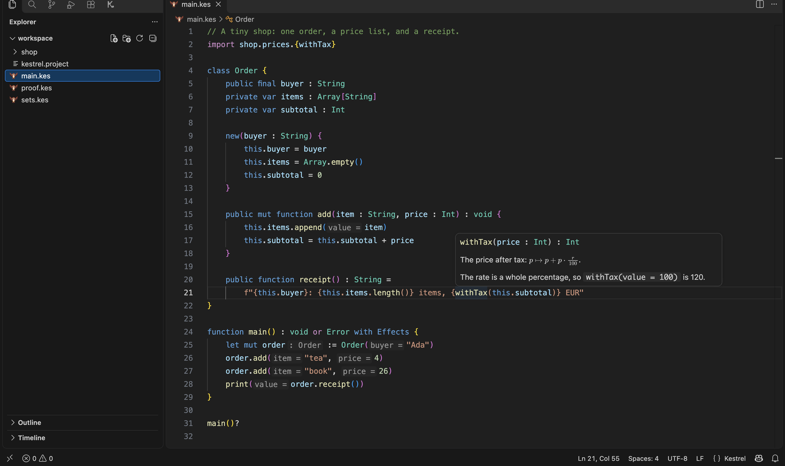
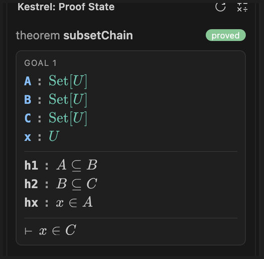

# Kestrel for VS Code

Support for `.kes` files: highlighting, completion, hover, inlay hints,
diagnostics, formatting and a live proof state.



## Install

**1. Install the compiler.** With Homebrew:

```sh
brew install GeronimoCastano/kestrel/kestrel
```

Or build it from source; the [repository](https://github.com/GeronimoCastano/kestrel)
has the steps.

**2. Install this extension.** Open the Extensions view and search **Kestrel**
by `kestrel-lang`. You can also install the `.vsix` from
[Releases](https://github.com/GeronimoCastano/kestrel/releases) with
**Install from VSIX...**.

**3. Open a `.kes` file.** The status bar shows **Kestrel**.

If the compiler is not on `PATH`, set `kestrel.compilerPath` to the binary.

## What it does

The extension is lightweight and syntactic. The compiler stays the source of
truth for types, effects and ownership, so every error you see comes from
`kestrel check`.

### Writing

- Completion for functions, classes, traits, enums, constants, keywords, built-in
  types and nearby names. After a dot it filters by the receiver's inferred type,
  including chains that end in `T or Error`.
- Snippets for `function`, `class`, `test`, `match` and `if`.
- Inlay hints for inferred `let` and `var` types, such as `tree : Node[Int]`.
- Gray parameter names at call arguments, `value = 3`, on every call or only on
  the cursor's line.
- Quick fixes for a class's missing trait methods, uncovered `match` arms and
  missing proof cases.
- Formatting with `kestrel fmt`, on save or with **Format Document**. The
  extension formats an unsaved buffer through `kestrel fmt --stdin`.

### Proving

- The **Kestrel Proof State** view follows the cursor inside a `by { ... }`
  block. It lists the variables, hypotheses and target of every open goal,
  updates as you type, and turns green when the kernel accepts the proof. A
  proof that still uses `sorry`, or leans on a trusted `smt` result, shows an
  amber badge; linear certificates checked by the kernel count as proved.
- Tactic completion offers the shape of each tactic, and the proof constructors
  `And`, `OrLeft`, `OrRight`, `Iff`, `Exists` and `True` complete inside a proof.
- A theorem call shows its parameters in signature help, and a theorem name in a
  proof shows its statement on hover.
- `\cup`, `\cap`, `\compl`, `\notin`, `\iff`, `\larr` and `\ot` expand to their
  symbols as you type.



Run **Kestrel: Show Proof State** from the Command Palette, or click the Kestrel
icon in the activity bar.

### Reading

- Hover for functions, classes, constants, locals, parameters, every tactic, and
  the standard library.
- Go to definition with F12 or Cmd-click for functions, classes, traits, enums
  and their cases, constants, fields and methods, across files.
- `///` documentation appears in hover, signature help and completion. Markdown
  works, and `$...$` and `$$...$$` render with bundled MathJax, offline, in light,
  dark and high-contrast themes, scaled with the editor font.
- An outline of classes, functions and constants.

### Checking

- The compiler checks your file as you type and reports its errors with their
  hints. One warm `kestrel serve` process per package keeps an edit in the
  millisecond range; a rebuilt compiler starts a new process.
- Project-local imports resolve from the file's path before you save, so an
  unsaved buffer does not report a missing import.
- In a notebook, a cell is read behind the cells above it, because the kernel
  runs the notebook as one session.

## Imports

```kestrel
import std.linalg                 // linalg.solve(A, b)
import std.linalg as la           // la.solve(A, b)
import std.linalg.{solve, lu}     // solve(A, b), lu(A)
```

The editor completes standard module paths and their exported names. Typing a
dot after a complete module path, as in `import std.linalg.`, offers that
module's names and inserts the one you pick as a selective import.

## Settings

| Setting | Default | What it does |
|---|---|---|
| `kestrel.compilerPath` | empty | The compiler to run. Empty uses `kestrel` on `PATH`. |
| `kestrel.checkOnType.enabled` | `true` | Check as you type. When off, a file is checked on save. |
| `kestrel.checkOnType.pauseMs` | `60` | Quiet time after the last keystroke before checking. |
| `kestrel.useServer` | `true` | Keep one warm `kestrel serve` per package folder. |
| `kestrel.inlayHints.parameterNames` | `always` | `always`, `cursorLine` or `off`. |
| `kestrel.inlayHints.parameterNameStyle` | `equals` | `value = 3` or `value: 3`. |
| `kestrel.inlayHints.types` | `true` | Inferred types after `let` and `var`. |
| `kestrel.proofState.enabled` | `true` | Follow the cursor with the proof state. |
| `kestrel.proofState.math` | `true` | Typeset propositions with TeX. |
| `kestrel.expandSymbols` | `true` | Turn `\in` into `∈` when you type a space. |

**Kestrel: Cycle Parameter Name Hints** switches between the three parameter
name modes.

## Troubleshooting

| Symptom | Fix |
|---|---|
| An error names a form the compiler should accept | The extension ran an older binary. Point `kestrel.compilerPath` at the current build and reload the window; the warm server restarts. |
| `kestrel` is not found | Install the compiler, or set `kestrel.compilerPath`. |
| The proof state stays empty | Put the cursor inside a `theorem` statement or its `by { ... }` block. |
| A `.kes` file opens as plain text | The extension is not active. Reload the window. |

## Limits

- Quick fixes need the warm checker (`kestrel.useServer`). An older compiler
  without the `actions` operation reports errors but offers no light bulb.
- A namespace import, such as `import facts`, adds the qualifier but not its
  members yet, and imports of imports are not followed.
- Project-local module paths are not suggested after `import`.
- Parameter-name hints follow the cursor's line. VS Code does not tell extensions
  where the mouse is, so a hint cannot appear on hover alone.

## Development

From this folder:

```sh
npm ci
npm run build          # bundle the MathJax renderer
npm test               # unit tests
npm run test:vscode    # drive a separate VS Code instance with an isolated profile
```

`../package-vscode-extension.sh` builds the VSIX without installing it.
